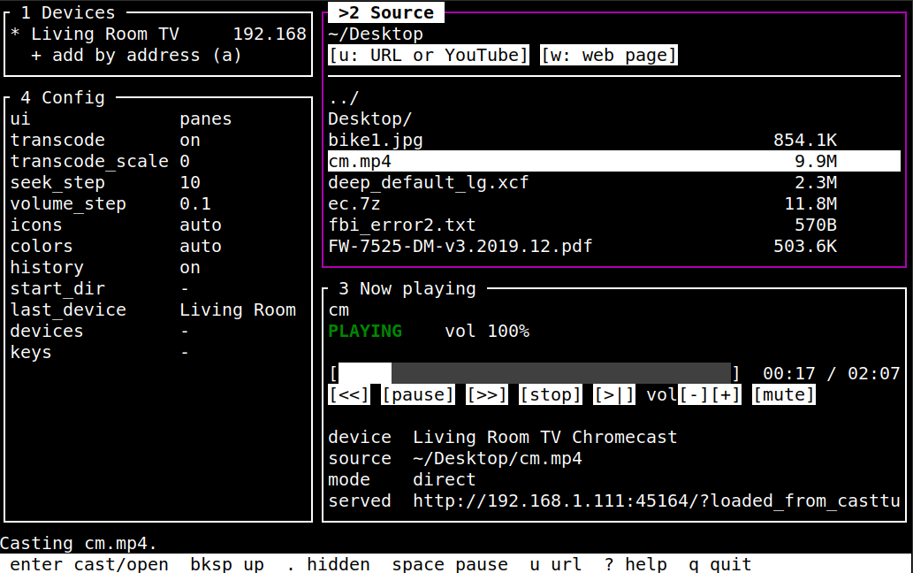

# casttui

A terminal remote for Chromecast. Pick a device, pick a file or paste a link, and control playback from the keyboard or mouse. Works in any terminal, over ssh, and on a bare Linux console. Built on [catt](https://github.com/skorokithakis/catt).

<p align="center">
  
</p>

It casts:

- **Local files**: video, audio and pictures, served to the device from this computer. Files the Chromecast can not decode are transcoded on the fly with ffmpeg.
- **Direct media URLs**.
- **YouTube** and any other site [yt-dlp](https://github.com/yt-dlp/yt-dlp) supports.
- **Web pages**, shown whole on the TV.

It remembers the last device and reconnects at start, keeps a history of what was cast, and every setting can be changed inside the app.

## Install

Debian, Ubuntu and derivatives, from the [tetronos apt repository](https://tetronos.github.io/apt/):

```sh
sudo curl -fsSLo /usr/share/keyrings/tetronos-archive-keyring.gpg https://tetronos.github.io/apt/tetronos-archive-keyring.gpg
sudo curl -fsSLo /etc/apt/sources.list.d/tetronos.sources https://tetronos.github.io/apt/tetronos.sources
sudo apt update && sudo apt install casttui
```

Or download `casttui_<version>_all.deb` from the [latest release](https://github.com/tetronos/casttui/releases/latest) and run `sudo apt install ./casttui_*.deb`. The package needs Python 3.11 or newer.

From source, with [uv](https://docs.astral.sh/uv/):

```sh
git clone https://github.com/tetronos/casttui && cd casttui
uv sync
uv run casttui
```

Optional: `ffmpeg` (transcoding and the codec check), `xclip` or `xsel` (middle-click paste into the URL field).

## Use

The computer and the Chromecast must be on the same network: local files are served to the device over HTTP from this computer.

```sh
casttui                          # find devices and open the interface
casttui ~/Videos/clip.mp4        # cast a file once a device is connected
casttui https://youtu.be/...     # or a URL
casttui -d 192.168.1.50          # connect by address, no scan
casttui --help                   # every option and setting
```

With a file or URL, casttui casts to the remembered device, or to the only Chromecast found. With several and none remembered, pick one and the cast starts.

### Panes

- **1 Devices**: found devices and saved addresses. `enter` connects, `a` adds a device by address (for one discovery can not see, such as on another subnet), `d` forgets an address, `r` scans again.
- **2 Source**: a file browser. `enter` casts a file or opens a folder, `backspace` goes up, `.` shows dot files. `u` asks for a link (direct media, YouTube or another yt-dlp site). `w` shows a web page.
- **3 Now playing**: title, state, volume, progress, device, and whether the file plays directly or is transcoded.
- **4 Config**: every setting. `enter` or `+`/`-` changes it, saved at once.
- **5 History**: past casts. `enter` casts again, `d` removes.

The layout follows the terminal width: three columns from 150 columns, two from 80, one pane with a tab strip below that.

### Keys

| Key | Action |
| --- | --- |
| `space` | play / pause |
| `h` `l`, arrows | seek |
| `+` `-` | volume |
| `m` | mute |
| `s` | stop |
| `n` | skip |
| `tab`, `1`-`5` | next pane, jump to pane |
| `z` | zoom the focused pane |
| `:` | command line: `set KEY VALUE`, `cast PATH\|URL`, `page URL`, `connect NAME\|IP`, `scan` |
| `?` | every key |
| `q` | quit, playback continues |
| `Q` | stop playback and quit |

Lists move with arrows or `j`/`k`. A click focuses a pane or row and a double click acts on it.

### Codecs and transcoding

casttui plays through the Chromecast's Default Media Receiver. H.264 video with AAC or MP3 audio always works. Other codecs (HEVC, AV1, ...) may play as audio only or not at all. If `ffmpeg` is installed, casttui checks the file first and, with `transcode` on (the default), streams it through a live H.264/AAC transcode, the same thing browsers and VLC do. This uses CPU and the stream can not be seeked. `transcode_scale` lowers the height to save CPU. With `transcode = false` such files are skipped with a warning.

## Configuration

`~/.config/casttui/config.toml` (honours `$XDG_CONFIG_HOME`). The Config pane edits it in place and keeps your comments. A missing or malformed file falls back to defaults, and a bad value falls back for that key only.

```toml
transcode = true        # ffmpeg-transcode codecs the device can not play
transcode_scale = 0     # height of the transcoded stream, 0 keeps the source
seek_step = 10          # seconds per seek key
volume_step = 0.1       # 0.0-1.0 per volume key
icons = "auto"          # ascii, unicode; auto is ascii on a bare console
colors = "auto"         # mono, 16, 256; NO_COLOR and TETRON_WM_COLORS are honoured
history = true          # keep History across runs
start_dir = ""          # Source pane folder, empty is the current folder
last_device = "Living Room TV"   # set on connect
devices = ["10.0.5.20"]          # saved addresses

[keys]                  # rebind any action, see ? in the app
quit = "x"
rewind = "h, left"
```

Environment: `CASTTUI_ICONS=ascii|unicode`, `CASTTUI_COLORS=mono|16|256`, `NO_COLOR`.

| File | Contents |
| --- | --- |
| `~/.config/casttui/config.toml` | settings, saved devices, key bindings |
| `~/.local/state/casttui/history.jsonl` | cast history, newest 200 |

## tetron-wm

casttui is part of the [tetronos](https://tetronos.github.io/) terminal desktop. In [tetron-wm](https://tetronos.github.io/tetron-wm/), right-click a media file and choose **Open with... casttui**, and it follows the desktop colour depth through `TETRON_WM_COLORS`.

## Development

```sh
uv sync
uv run pytest     # no Chromecast needed
```

See [CHANGELOG.md](CHANGELOG.md) for release notes.

## License

MIT. See [LICENSE](LICENSE).
